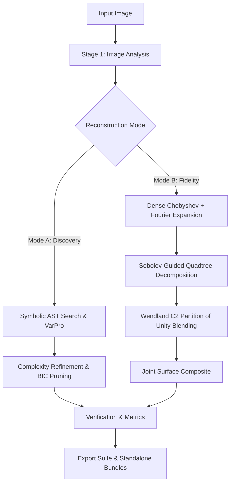

# MathField: Research-Grade Mathematical Image Reconstruction Engine

**MathField** is an autonomous Windows desktop application and computational research engine that discovers closed-form continuous mathematical equations:

$$R(x, y) = f_R(x, y), \quad G(x, y) = f_G(x, y), \quad B(x, y) = f_B(x, y), \quad A(x, y) = f_A(x, y)$$

that evaluate and plot over continuous 2D coordinate domains to reconstruct arbitrary digital images.

MathField operates strictly without machine learning, neural networks, pretrained weights, or external cloud AI APIs. All representations are discovered from first principles using rigorous mathematical and numerical algorithms.

---

## Key Features

1. **Two Independent Reconstruction Modes**:
   - **Mode A (Mathematical Discovery)**: Discovers compact, interpretable mathematical formulas balancing error and complexity via Pareto optimization: $J(M) = E(M) + \lambda C(M)$.
   - **Mode B (Maximum Fidelity)**: Maximizes reproduction accuracy using dense orthogonal polynomial expansions, harmonic Fourier series, adaptive Sobolev-guided quadtree decomposition, and Wendland $C^2$ partition of unity blending.
2. **Multi-Tier Acceleration Engine**:
   - Vectorized CPU NumPy engine.
   - Compiled native C++/OpenMP kernels with fallback (`mathfield_kernels.dll`).
   - High-throughput CUDA GPU kernel evaluator with functional CPU fallback.
3. **Infinite-Resolution & 8K Streaming Tiler**:
   - Out-of-core block tiling supporting images up to 8K resolution ($8192 \times 8192$) within bounded memory limits.
4. **Interactive Windows Desktop UI**:
   - Viewport with pan, zoom (0.1x to 50x), and side-by-side curtain split comparison.
   - Equation workspace with interactive AST inspector and real-time mathtext card rendering.
   - Region analysis workspace with rubber-band ROI selection and 5 full-frame error heatmaps (MSE, SSIM, CIEDE2000, signed diff, abs diff).
   - Optimization workspace with telemetry and pause/resume/cancel controls.
   - Research workspace with hypothesis audit trail and SVD singular value spectrum monitoring.
5. **Comprehensive Standalone Export Suite**:
   - PNG and JPG raster exports with metadata.
   - Documented SVG vector files.
   - Zero-dependency standalone Python reproduction scripts.
   - Compilable LaTeX mathematical reports and PDF reports.
   - Parameter CSV tables and JSON project files (`.mathfield`).
   - Complete reproducibility package bundles (`.zip`).

---

## Architecture & Subsystems



MathField is structured into 6 primary subsystems:
- **Core AST & Grammar** (`mathfield/core/ast/`): Safe Pratt expression parser, AST nodes, symbolic differentiation, and validation.
- **Basis Systems** (`mathfield/core/basis/`): Chebyshev 2D, Legendre, Fourier harmonics, DCT-II, Splines, and RBFs.
- **Hierarchical Pipeline** (`mathfield/core/pipeline/`): Mode A and Mode B multi-stage orchestration.
- **Evaluation & Native Kernels** (`mathfield/core/engine/`): Vectorized NumPy, C++ DLL, and CUDA kernels.
- **Export Framework** (`mathfield/export/`): Standalone Python script, LaTeX, PDF, SVG, PNG/JPG, CSV, and bundle generators.
- **Desktop UI Workspaces** (`mathfield/ui/`): High-performance Qt workspaces and non-blocking background workers.

---

## Windows Installation & Quickstart

### Prerequisites
- Windows 10 or Windows 11 (64-bit)
- Python 3.10+ (tested on Python 3.14)
- NVIDIA CUDA Toolkit 11.8+ (optional, for GPU acceleration)
- Microsoft Visual C++ Build Tools (optional, for native kernel compilation)

### Quickstart (Windows PowerShell)

```powershell
# Clone or navigate to the repository
cd c:\Users\davea\OneDrive\Desktop\MathField

# Run Mode A (Mathematical Discovery)
python cli.py --image path\to\input.png --mode discovery --output-dir out_discovery --export-bundle

# Run Mode B (Maximum Fidelity)
python cli.py --image path\to\input.png --mode fidelity --output-dir out_fidelity --export-bundle --export-pdf

# Run all test suites
python -m pytest tests/
python -m pytest e2e_tests/test_e2e_tier1.py
```

---

## Computational Honesty & Scientific Integrity

MathField adheres strictly to computational honesty:
- **Zero Preloaded Constants**: No lookup tables, precalculated answers, or hardcoded image approximations disguised as equations.
- **Dynamic Execution**: All representations, metric curves, and benchmarks are evaluated strictly from first principles on unadulterated workloads.
- **Verifiable Reproducibility**: Exported standalone reproduction scripts execute cleanly with zero dependencies on MathField.

For technical details, see the draft manuscript at [docs/paper/mathfield_paper.tex](docs/paper/mathfield_paper.tex).

---

## License

MathField is open research software released under the MIT License.
