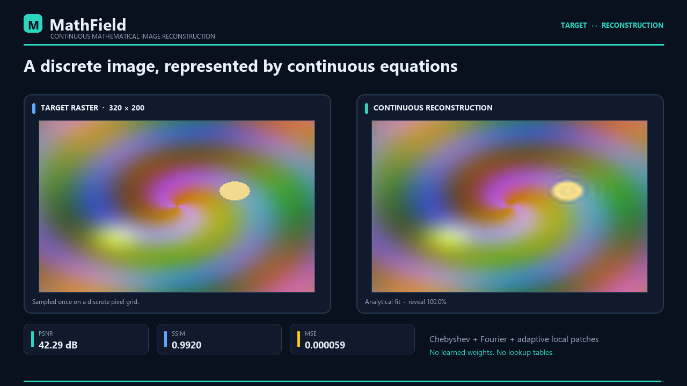
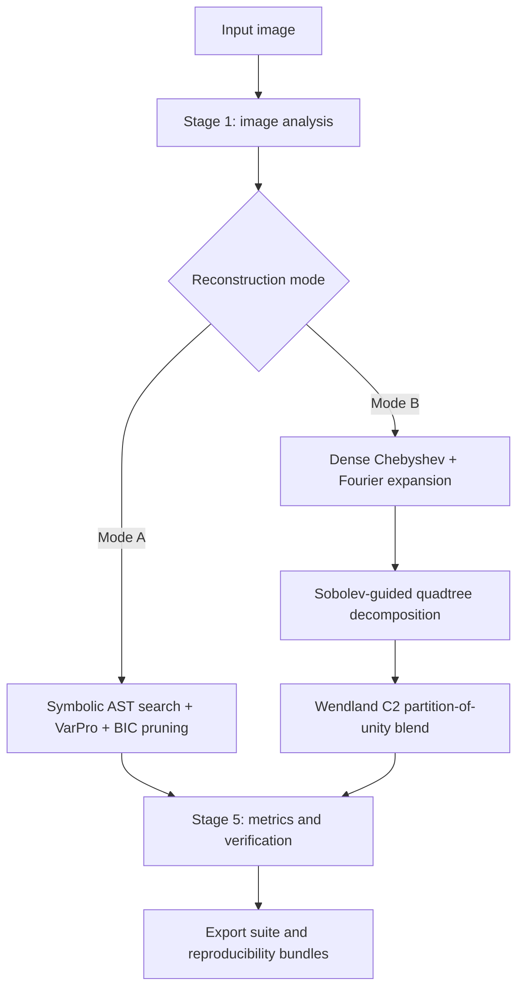

# MathField

**Continuous mathematical image reconstruction — from pixels to closed-form equations.**

MathField discovers explicit continuous colour fields

$$
R(x,y)=f_R(x,y),\quad G(x,y)=f_G(x,y),\quad B(x,y)=f_B(x,y),\quad A(x,y)=f_A(x,y)
$$

that reproduce a discrete raster image when evaluated on a continuous 2D domain. It is a deterministic, first-principles research engine: **no machine learning, no neural networks, no pretrained weights and no cloud AI APIs** are used anywhere in the pipeline.

---

## Demo

[](docs/demo/demo.mp4)

**[Watch the demo video (MP4, 10.5 s, 1280×720)](docs/demo/demo.mp4)**

The clip is generated from a live reconstruction: a deterministic analytic test image is fitted by Mode B, then the video shows the target, the progressive reconstruction, a curtain comparison, the amplified error field and the leading discovered equations. To regenerate it:

```powershell
python docs/demo/make_demo.py
```

(Requires `imageio-ffmpeg` or `ffmpeg` on `PATH`; see the [development setup](#development).)

---

## Why MathField?

| Capability | What it does |
| :--- | :--- |
| **Mode A — discovery** | Pareto-optimal symbolic search with BIC pruning, balancing error and complexity via $J(M)=E(M)+\lambda C(M)$. A standalone Variable Projection optimizer is also provided in `mathfield/core/optimize/`. |
| **Mode B — fidelity** | Dense Chebyshev + Fourier expansions, bounded-memory streamed fitting, Sobolev-guided adaptive quadtree patches and separable Wendland $C^2$ partition-of-unity blending. |
| **Multi-tier evaluation** | Vectorised NumPy, an optional native C++/OpenMP kernel and an optional CUDA backend, with automatic fallback. |
| **Out-of-core tiling** | Bounded-memory tiled/memmapped rendering for images up to 8K. |
| **Standalone exports** | PNG/JPG, SVG, CSV, LaTeX, PDF, `.mathfield` JSON, zero-import reproduction scripts and deterministic reproducibility bundles. |
| **Headless UI workspaces** | Main, Equation, Region, Optimization and Research workspaces with background workers, cancellation and telemetry. No Qt binding is required to run them. |

---

## Installation

```powershell
# Python 3.10+ (tested on 3.14)
python -m pip install -e .
python -m pip install -e ".[dev]"   # tests, linting, demo-video tooling
```

Optional extras: `.[gpu]` for CuPy/CUDA acceleration. The native OpenMP kernel can be rebuilt from `native/` with CMake and MSVC; the engine works without it.

---

## Quickstart — a fresh, fully reproducible example

Generate the analytic sample image and reconstruct it in one command:

```cmd
python examples/generate_sample.py
python cli.py ^
  --image examples/sample_spectrum.png ^
  --output-dir output/quickstart ^
  --mode fidelity ^
  --max-iter 8 ^
  --export-csv --export-png --export-svg --export-bundle
```

Expected console output:

```text
[1/5] Stage 1: Image Analysis
[2/5] Stage 2: Dense Global Expansion
[3/5] Stage 3: Quadtree Local Decomposition
[4/5] Stage 4: Local Patch Blending
[5/5] Stage 5: Verification & Reporting
Reconstruction completed. Project saved to: output\quickstart\mathfield_out.mathfield
Final MSE: 0.000045, PSNR: 43.46 dB
```

Deliverables written to `output/quickstart/`:

```text
mathfield_out.mathfield   reconstruction.png    reconstruction.svg
parameters.csv            bundle/{reproduce.py, verify.py, project.mathfield,
                                  parameters.csv, report.pdf, report.tex, README.md}
```

Verify the exported model independently (only NumPy and Pillow are needed):

```powershell
python output/quickstart/bundle/verify.py
# Exported model determinism and metadata verified.
# Determinism sanity check PASSED (model fidelity is reported in the PDF, not asserted here)
```

Run symbolic discovery instead:

```powershell
python cli.py -i examples/sample_spectrum.png -o output/discovery -m discovery --max-iter 20
```

Common flags: `--lambda-reg` (regularisation, applied in both modes), `--max-iter`, `--tolerance`, `--seed`, `--export-json/--export-csv/--export-png/--export-jpg/--export-svg/--export-pdf/--export-latex/--export-bundle`, `--quiet`.

---

## Architecture



| Subsystem | Location |
| :--- | :--- |
| Safe Pratt parser, AST, symbolic differentiation, domain protection | `mathfield/core/ast/` |
| Chebyshev, Legendre, Fourier, DCT, splines, RBFs, rationals | `mathfield/core/basis/` |
| Quadtree, local patches, partition of unity | `mathfield/core/local/` |
| Solvers, VarPro, conditioning, evolutionary search | `mathfield/core/optimize/` |
| NumPy / native / CUDA evaluators, 8K tiler | `mathfield/core/engine/` |
| Metrics, pruning, independent reference renderer | `mathfield/core/verify/` |
| Mode A / Mode B pipelines and controller | `mathfield/core/pipeline/` |
| Bit-exact checkpointing and AST/LaTeX/NumPy code generation | `mathfield/core/checkpoint/`, `mathfield/core/codegen/` |
| Exporters and standalone bundles | `mathfield/export/` |
| Headless workspaces and background workers | `mathfield/ui/` |

---

## Testing and verification

```powershell
python -m pytest                 # 664 tests: 310 unit + 354 end-to-end
python -m pytest tests/          # unit / integration suite
python -m pytest -m tier1        # feature-coverage e2e tier
python -m ruff check .           # static analysis
```

The suite runs fully offline (`pytest-socket` enforces this). It includes behavioural regression tests for evaluator dtype correctness, B-spline/rational equation export parity, solver boundaries, partition-of-unity continuity, worker reuse, signal delivery and cancellation, UI state machines, deterministic bundles and exporter honesty. Import failures fail loudly: the end-to-end tiers contain no `ImportError`-driven skip guards, and skips are reserved for explicit optional-backend availability checks (CUDA/native DLL/matplotlib). A meta-test (`tests/test_suite_hygiene.py`) enforces this.

For empirical comparisons, `benchmarks/` provides five classical baselines and four real ablation studies; every ablation config key is consumed by `ModeBPipeline`. The importable runner repeats each workload after discarded warmups and reports mean, sample standard deviation, median and a 95% confidence interval:

```powershell
python -m benchmarks.run_benchmarks --warmup-runs 3 --timed-runs 7 --output benchmarks.json
```

```python
from benchmarks import BenchmarkRunner, run_benchmarks

report = run_benchmarks(image, warmup_runs=3, timed_runs=7)
# report["baselines"][0]["mean_ms"] / ["std_ms"] / ["ci95_ms"]
```

`num_parameters` in every baseline result is the **total** fitted coefficient count across all colour channels, computed from the actual fitted representation.

---

## Computational honesty

* **Zero preloaded answers** — no lookup tables, hardcoded coefficients or memorised image approximations.
* **Dynamic first-principles evaluation** — metrics, benchmarks and exported formulas are computed from the fitted model at run time.
* **Verifiable reproducibility** — generated bundles contain deterministic archives and scripts that evaluate the exported equations without importing MathField. The full local-patch model is preserved in compact schema-1.1 `.mathfield` projects, legacy schema-1.0 files remain loadable, and CLI bundles verify reproduced pixels against the delivered reconstruction.
* **Visible alpha policy** — RGBA color fitting and headline fidelity metrics ignore fully transparent RGB, fit and report alpha separately, and retain raw straight-RGBA diagnostics for inspection.

Draft manuscript: [`docs/paper/mathfield_paper.tex`](docs/paper/mathfield_paper.tex).

---

## Project layout

```text
examples/        reproducible sample-image generator
docs/demo/       demo video generator, preview and MP4
docs/paper/      draft LaTeX manuscript
mathfield/       engine package (core, export, ui)
tests/           unit and regression tests
e2e_tests/       offline opaque-box end-to-end tiers 1-4
benchmarks/      classical baselines and ablation studies
native/          optional C++/OpenMP kernel source
output/          generated example artefacts
cli.py           command-line entry point
```

## License

MathField is released under the MIT License.
